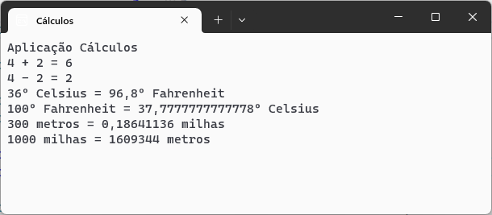

# Cálculos :1234:
Aplicação c# para efetuar cálculos

Desenvolvida no âmbito da ação de formação **Introdução ao Git e GitHub**

## Operações suportadas

Neste momento esta aplicação implementa as seguintes operações:
- soma 
- subtração
- multiplicação
- conversão de temperaturas
    - celsius :arrow_right: fahrenheit
    - fahrenheit :arrow_right: celsius
- conversão de distâncias
    - metros :arrow_right: milhas
    - milhas :arrow_right: metros

## Tecnologias utilizadas neste projeto

- Visual Studio Code
- C#
- Git
- GitHub Desktop
- Plataforma GitHub

<!--
## Site oficial

Faça download desta aplicação no site oficial: [www.calculos.com](https://www.calculos.pt)

-->